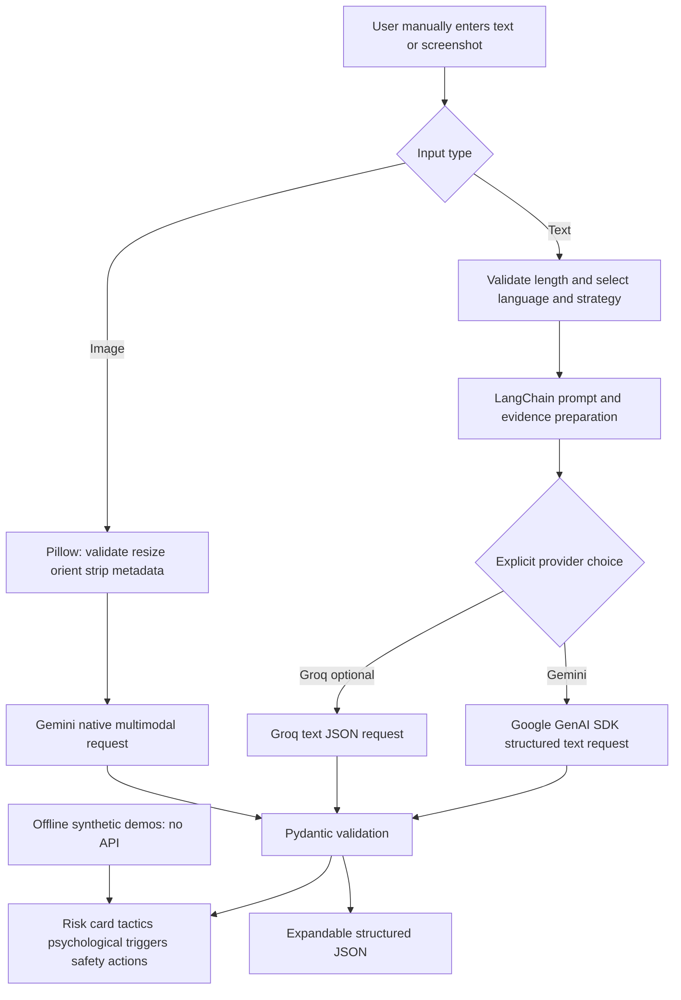

# System Architecture — VeritasGuard

## Runtime pipeline

## Modules
- `app.py`: Streamlit UI and explicit Analyze event; provider and prompting configuration for text, Gemini-only screenshot; language and JSON display.
- `analyzer.py`: one text LLM request through a `RunnableLambda → ChatPromptTemplate → RunnableLambda(provider) → RunnableLambda(Pydantic)` sequence. The provider stage uses Gemini or Groq SDK. If `langchain-core` is not installed, Gemini keeps a compatibility path, but installation is expected.
- `image_analyzer.py`: Pillow checks 8 MB, max 20 megapixels, permitted PNG/JPEG, EXIF orientation, downsampling, JPEG output without metadata; sends one Gemini vision request with image bytes. No separate OCR module.
- `schema.py`: `FraudAnalysisResult` and `RiskLevel`; optional grounding and provider fields.
- `taxonomy.py`: project-defined scam categories used to guide prompts, **not official government categories**.

## Trust boundaries
1. Pasted text or screenshot content is **untrusted data**; delimiters and prompts are a mitigation, not a guarantee against prompt injection.
2. No received link is visited and no embedded code is executed.
3. Google receives text/image only on submission; Groq receives text only if explicitly selected or if user checked opt-in fallback.
4. No API keys, raw response bodies or screenshots should appear in application logs.
5. Generated JSON structure is checked; factual accuracy still requires human judgment and independent verification.

## Limitations
The tool provides advisory risk explanations, not proof of criminal activity. It does not intercept messages, decode QR payloads, inspect phone reputation, or determine external site authenticity. Image preprocessing removes metadata, **not** visually displayed sensitive information.
